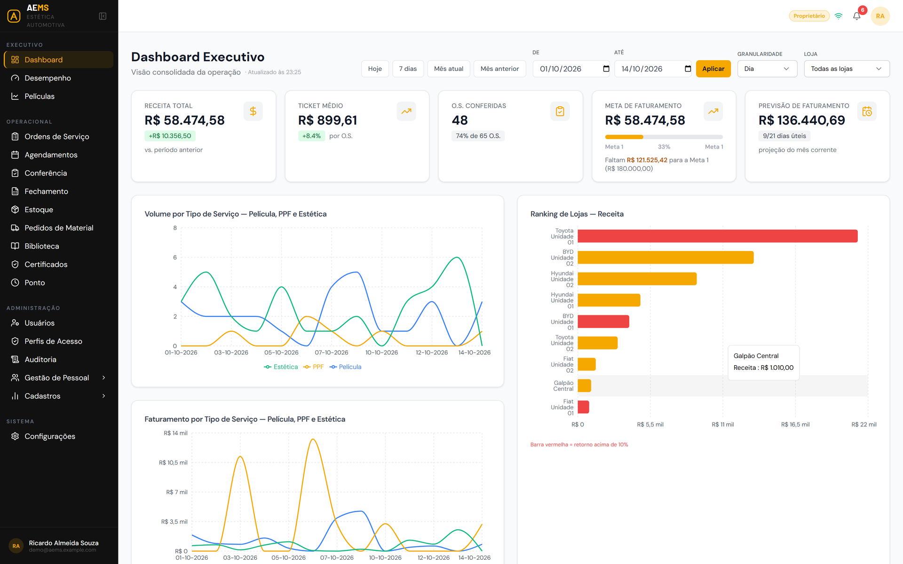
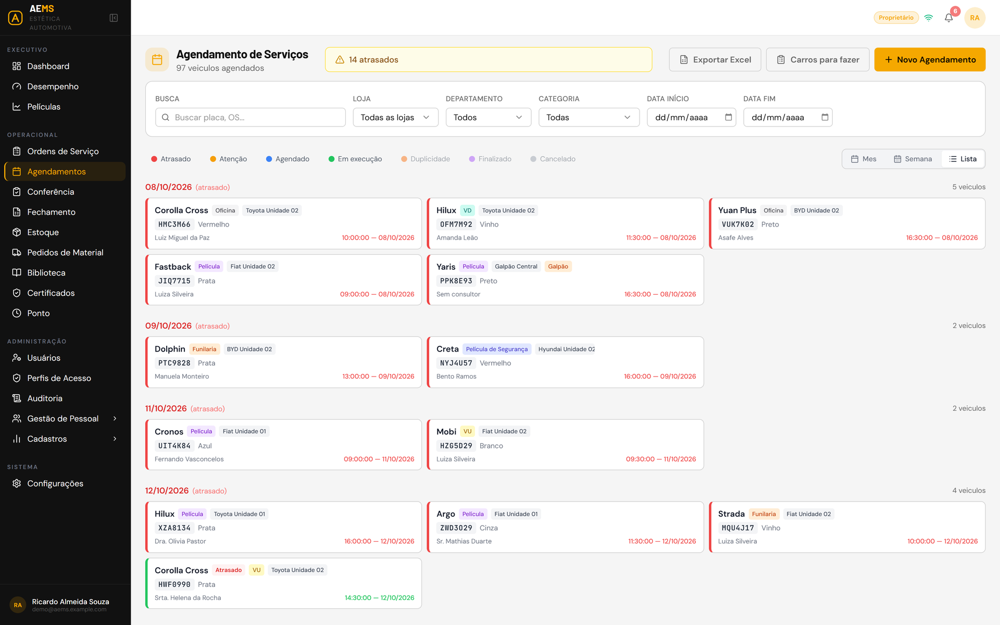
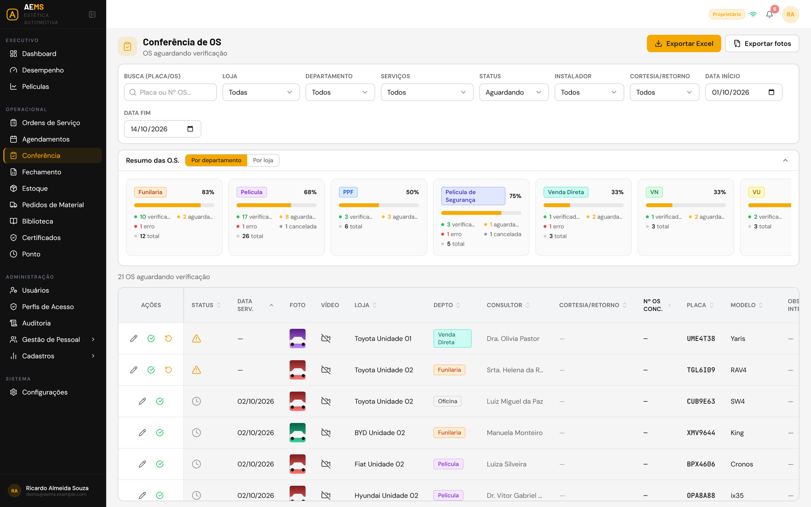
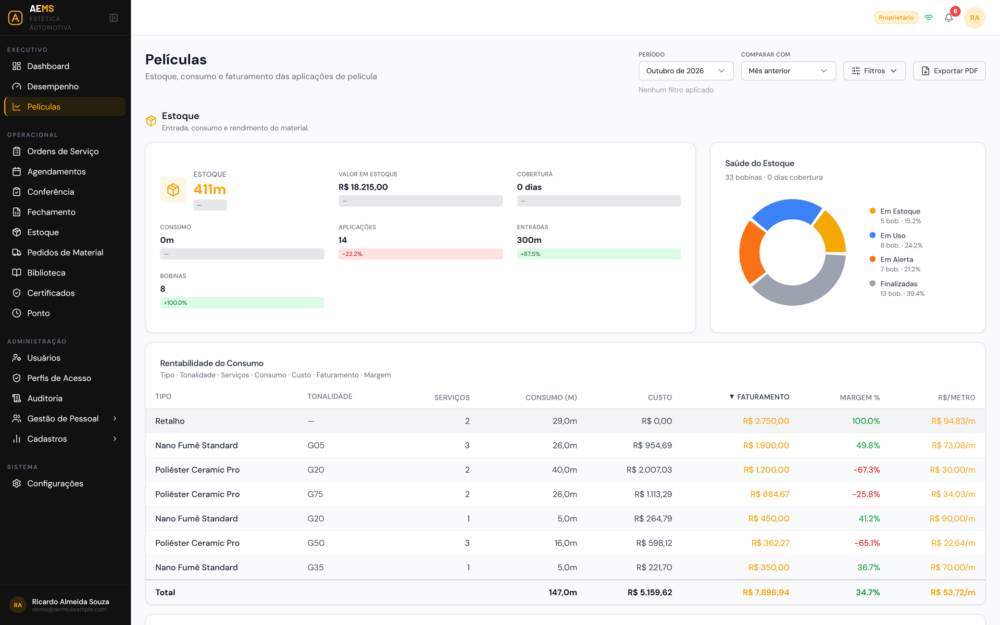
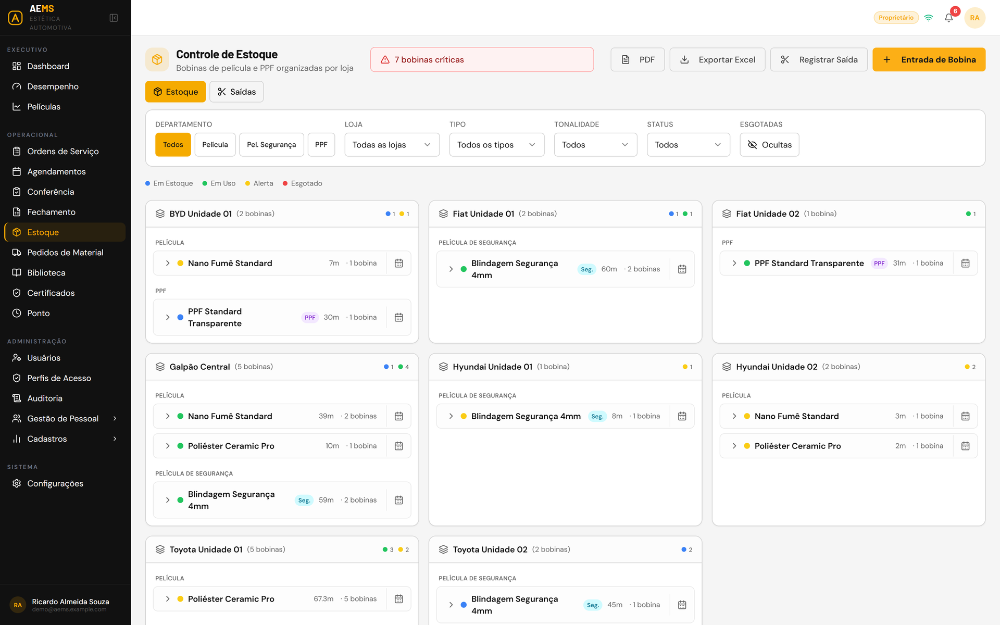
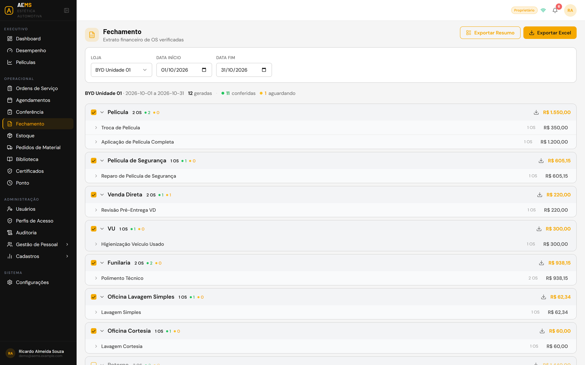
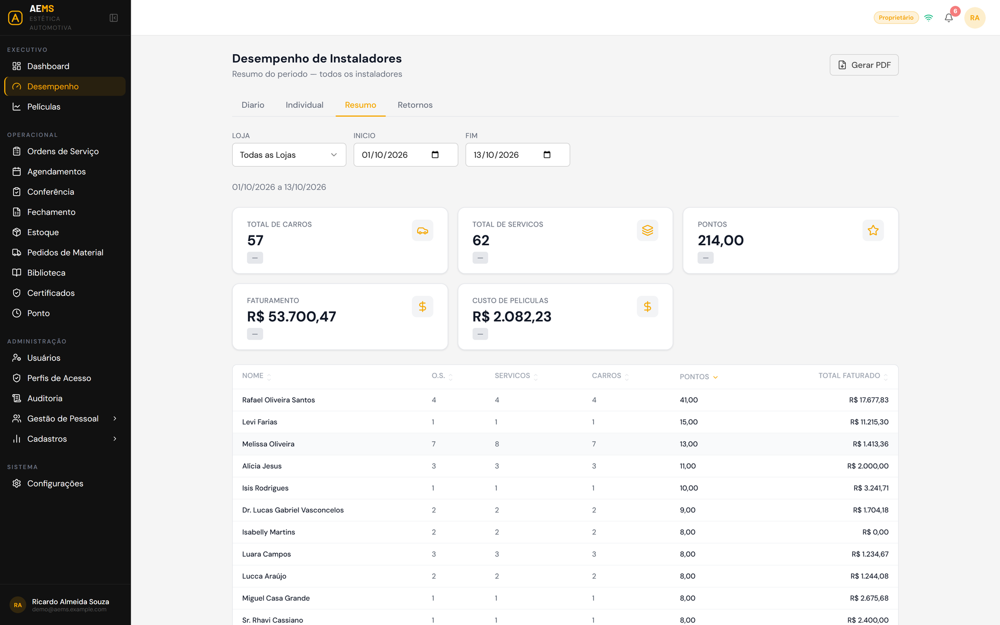
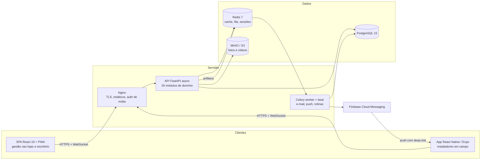

<div align="center">

# AEMS — Auto Estética Management System

**Plataforma de gestão operacional para uma rede de lojas de estética automotiva instaladas dentro de concessionárias.**
API + aplicação web (PWA) + app Android para a equipe de campo — em produção.




</div>

---

## Resumo

| | |
|---|---|
| **Problema** | Uma rede com 15 lojas dentro de concessionárias de várias montadoras controlava ordens de serviço, agenda, estoque de películas e ponto da equipe em planilhas e mensagens — sem rastreabilidade de material, sem visão consolidada e com retrabalho no fechamento mensal. |
| **Solução** | Sistema único, do agendamento à finalização da O.S. com foto, consumo de bobina rastreado por SMART ID, conferência, fechamento, ponto eletrônico e indicadores — no navegador para a gestão e no app para os instaladores em campo. |
| **Resultado** | Em produção desde o 1º semestre de 2026: **+14 mil ordens de serviço** registradas, **60+ usuários** ativos, estoque e consumo de material auditáveis por bobina e fechamento mensal gerado pelo sistema. |
| **Meu papel** | **Desenvolvedor full-stack único** — levantamento com o cliente, arquitetura, backend, web, mobile, testes, CI/CD, deploy e operação. |

> **Sobre este repositório** — é a vitrine de um projeto real e proprietário. O **código-fonte não é publicado**
> por pertencer ao cliente; aqui estão a visão do produto, a arquitetura, as decisões técnicas (ADRs) e as telas.
> Os dados do cliente foram anonimizados e as telas usam **apenas dados fictícios**.
>
> 🔎 **Demonstração ao vivo:** um ambiente com dados fictícios pode ser disponibilizado para avaliação — veja [Contato](#contato).

---

## Em números

| Métrica | Valor |
|---|---|
| Endpoints REST | **214** em **26 módulos** de domínio |
| Migrations versionadas (Alembic) | **149** |
| Testes automatizados | **1.522** pytest · **774** Jest (mobile, 96 suítes) · **203** Vitest + E2E Playwright (web) |
| Código | **~220 mil linhas** (Python + TypeScript, incluindo testes) |
| Interfaces | **40** páginas web · **62** telas mobile |
| Decisões documentadas | **46 ADRs** — [10 selecionados aqui](docs/adr/README.md) |

---

## Telas

> Dados fictícios gerados por um script de demonstração (nenhum dado real do cliente).

### Web (gestão)

| | |
|---|---|
|  |  |
| **Agendamento** — visão por loja/departamento, atrasos e exportação | **Conferência** — validação das O.S. com fotos e anotações |
|  |  |
| **Películas** — estoque × faturamento e rentabilidade do consumo | **Estoque** — bobinas rastreáveis por SMART ID |
|  |  |
| **Fechamento** — extrato por departamento e serviço, pronto para faturar | **Desempenho** — carros, serviços, pontos e faturamento por instalador |

### Mobile (equipe de campo)

App Android em React Native + Expo usado pelos instaladores nas lojas: abertura e finalização de O.S. com fotos e vídeo,
agenda do dia, consulta e baixa de bobinas, ponto eletrônico com selfie + GPS (funciona offline), notificações push com
deep-link e desbloqueio por biometria. Mesma API e mesma camada de dados (tipos, *services* e *hooks*) do web.

---

## Arquitetura



- **Monólito modular**: cada domínio em `app/modules/<módulo>/` com `router → service → schemas → models`; regras de negócio só no *service*.
- **Autorização no backend**: perfis de acesso granulares (submódulo × ação) + escopo por loja aplicado em toda consulta; o front apenas espelha (*fail-closed*).
- **Web e mobile compartilham a camada de dados**: mesmos tipos, *services* HTTP e *hooks* TanStack Query.
- **Tempo real**: WebSocket por sala (loja/usuário) e push FCM com deep-link para a tela certa.

📄 Detalhes, diagramas de fluxo e decisões de segurança em **[docs/architecture.md](docs/architecture.md)**.

---

## Destaques de engenharia

| Desafio | Como foi resolvido | Decisão |
|---|---|---|
| **Ponto eletrônico confiável, inclusive offline** | NSR persistido sob *advisory lock*, cadeia de hash SHA-256 verificável, horário real do dispositivo para batidas offline e comprovante ao trabalhador (Portaria 671). | [ADR 0007](docs/adr/0007-ponto-eletronico-nsr-cadeia-de-hash-offline.md) |
| **Estoque de película rastreável** | Saldo da bobina derivado de um extrato (*ledger*) de consumos, nunca editado à mão; retalho como marcação sem novo débito. | [ADR 0002](docs/adr/0002-estoque-como-extrato-e-retalho-como-marcacao.md) |
| **Corrigir dados históricos sem criar erros novos** | Correção na causa + *backfill* conservador que só religa casos inequívocos, com *dry-run* por padrão. | [ADR 0005](docs/adr/0005-consumo-orfao-gap-fix-e-backfill-conservador.md) |
| **Bug intermitente em produção** | Análise de causa-raiz de um HTTP 422 revelou superconsumo silencioso; correção guiada por teste de regressão. | [ADR 0004](docs/adr/0004-consumo-por-tonalidade-distinta-na-finalizacao.md) |
| **Tela lenta** | Medição refutou a hipótese de N+1; solução com *prefetch* por intenção e cache Redis com chave por escopo de loja. | [ADR 0009](docs/adr/0009-prefetch-por-intencao-e-cache-de-catalogos.md) |
| **Fotos em rede móvel instável** | Upload com paralelismo limitado, compressão serial e fila com nova tentativa. | [ADR 0008](docs/adr/0008-upload-de-fotos-mobile-perfil-moderado.md) |
| **Controle de acesso flexível e seguro** | Papéis fixos substituídos por perfis granulares validados no backend; recurso de outra loja responde 404, não 403. | [ADR 0001](docs/adr/0001-perfis-de-acesso-granulares.md) |

➡️ Todos os registros: **[docs/adr](docs/adr/README.md)**.

---

## Funcionalidades

| Área | O que faz |
|---|---|
| **Ordens de Serviço** | Abertura com fotos obrigatórias, vídeo de início/fim, finalização pelo instalador com relato técnico, serviços com várias tonalidades de película, retornos vinculados à O.S. de origem e auditoria. |
| **Agendamento** | Visão dia/semana/mês por loja e departamento, controle de atrasos, filtros persistidos e exportação Excel/PDF. |
| **Películas e estoque** | Bobinas com SMART ID, consumo por serviço, retalho, rebalanceamento entre lojas, rentabilidade do consumo e relatórios PDF gerados no backend. |
| **Pedidos de material** | Bobinas e ferramentas por fornecedor, edição com reconciliação de estoque e trilha de auditoria, cancelamento com motivo. |
| **Conferência e fechamento** | Conferência de O.S. com fotos e anotações; fechamento mensal por departamento em Excel. |
| **Ponto eletrônico** | Marcação por selfie + GPS no app, funcionamento offline, espelho, comprovante e exportação AFD/AEJ. |
| **Pessoas** | Funcionários, EPI e ferramentas com foto por item, desempenho de instaladores (retornos e pontuação). |
| **Gestão** | Dashboard executivo com metas, rankings e resumo diário; biblioteca técnica e certificado de garantia em PDF. |
| **Plataforma** | Perfis de acesso granulares, notificações em tempo real (WebSocket + push), auditoria e *feature flags* por ambiente. |

---

## Qualidade e processo

- **Gate obrigatório antes de qualquer entrega** — o mesmo que roda no CI (GitHub Actions):
  - API: `ruff check` · `ruff format --check` · `mypy` · `pytest`
  - Web: `eslint` · `tsc -b` · `vitest` · build de produção
  - Mobile: `eslint` · `tsc` · `jest`
- **TDD em regras críticas** (estoque, ponto, permissões) e testes de regressão para todo bug de produção.
- **Code review** de cada entrega antes do merge, com foco em autorização, integridade de dados e regressões.
- **ADR para cada decisão** de negócio ou arquitetura e changelog contínuo das entregas.
- **Ambientes separados** de homologação e produção; o cliente valida em homologação antes de cada release.
- **Migrations versionadas** com *backfills* idempotentes e *dry-run*; rotina de backup diário do banco e das fotos, com procedimento de restauração documentado.
- **Observabilidade** com logs estruturados, trilha de auditoria e Sentry no app mobile.

---

## Stack

| Camada | Tecnologias |
|---|---|
| **Backend** | Python 3.11 · FastAPI · SQLAlchemy 2.0 (async) · Alembic · PostgreSQL 15 · Redis 7 · Celery · Pydantic v2 · fpdf2 / openpyxl · MinIO (S3) |
| **Web** | React 19 · TypeScript 5.9 · Vite 6 · TailwindCSS 3 · Radix UI / shadcn · TanStack Query v5 · Zustand 5 · React Hook Form + Zod · Recharts · PWA (Workbox) |
| **Mobile** | React Native 0.81 · Expo SDK 54 · NativeWind v4 · TanStack Query v5 · Zustand · React Navigation · Expo Notifications (FCM) · biometria · câmera e vídeo |
| **Testes** | pytest · Vitest + Testing Library + MSW · Playwright · Jest + RN Testing Library · Maestro (E2E mobile) |
| **Infra** | Docker Compose · Nginx · GitHub Actions · VPS Linux · Let's Encrypt |

---

<details>
<summary><b>Organização do código (projeto original)</b></summary>

```
├── app/                    # API FastAPI
│   ├── core/               # segurança, permissões, paginação, auditoria, rate limit
│   ├── db/                 # sessão e base do SQLAlchemy
│   ├── modules/            # 26 módulos: router · service · schemas · models
│   ├── websocket/          # salas por loja/usuário
│   └── workers/            # Celery (e-mail, push, rotinas)
├── alembic/versions/       # 149 migrations
├── tests/                  # unit + integration (pytest)
├── frontend/src/           # SPA React
│   ├── pages/ components/ hooks/ services/api/ stores/ types/
│   └── e2e/                # Playwright
├── mobile/src/             # app React Native + Expo
│   ├── screens/ components/ navigation/ hooks/ services/ stores/ providers/
│   └── .maestro/           # E2E mobile
├── docs/                   # arquitetura, ADRs, PRD e operação
└── .github/workflows/      # CI e deploy
```
</details>

---

## Contato

**Jean Diniz** — Desenvolvedor Full-Stack
[GitHub](https://github.com/JeanDinniz)

Acesso ao ambiente de demonstração (dados fictícios) e conversa técnica sobre o código sob solicitação.

<sub>Projeto proprietário — todos os direitos reservados. Conteúdo disponibilizado apenas para avaliação.</sub>
