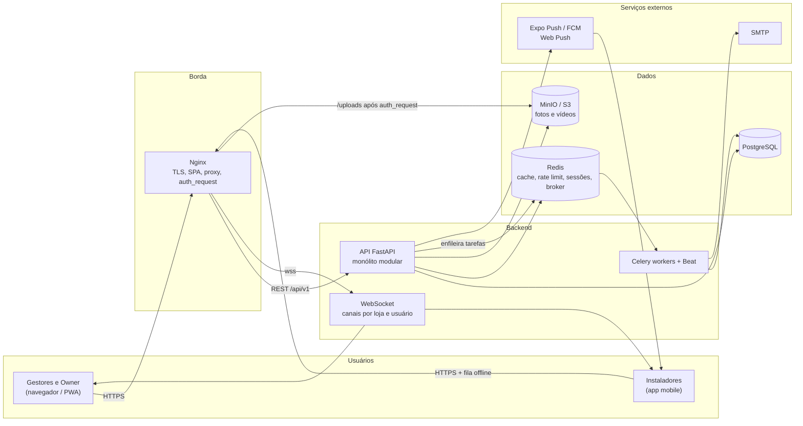
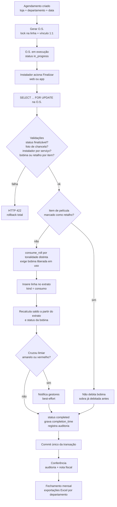
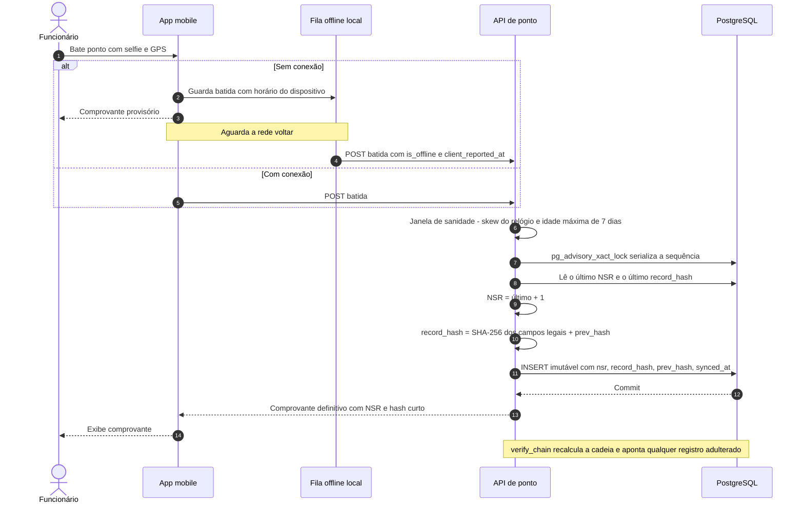

# Arquitetura do AEMS

> **AEMS** (Auto Estética Management System) é um sistema em produção para a gestão de uma **rede de
> lojas de estética automotiva** — instalação de película, funilaria e estética — que atende
> concessionárias parceiras (Toyota, BYD, Fiat, Hyundai). Desenvolvido e operado por um único
> desenvolvedor full-stack. Este documento descreve a arquitetura para um leitor técnico; as decisões
> mais relevantes estão detalhadas nos [ADRs](adr/README.md).

## 1. Problema e escopo

O sistema resolve quatro dores da operação:

- **Visibilidade em tempo real** do que cada loja está executando.
- **Controle de estoque de película** por bobina física, com consumo rastreável por carro.
- **Produtividade individual** dos instaladores.
- **Padronização** de processos entre as lojas.

Principais capacidades: ciclo completo da Ordem de Serviço (agendamento → execução → finalização →
conferência → fechamento mensal), inventário de película com alertas de estoque, ponto eletrônico com
selfie + GPS (aderente aos princípios da Portaria MTP 671/2021), dashboard executivo, desempenho de
instaladores, pedidos de material, notificações em tempo real e um app mobile para o chão de loja.

## 2. Componentes

| Componente | Tecnologia | Papel |
|---|---|---|
| **API** | FastAPI (Python), SQLAlchemy 2.0 **assíncrono**, Pydantic v2 | Monólito modular: regras de negócio, autorização, persistência. |
| **Banco de dados** | PostgreSQL | Fonte de verdade. Migrations versionadas com Alembic (aplicadas automaticamente no deploy). |
| **Cache / broker** | Redis | Cache de leitura (catálogos, analytics), *rate limit*, blacklist de tokens / sessão única, broker do Celery. |
| **Workers** | Celery + Celery Beat | Tarefas assíncronas e agendadas: e-mail (reset de senha), lembretes de ponto, expurgo periódico de logs de auditoria. |
| **Armazenamento de mídia** | MinIO (compatível com S3) | Fotos e vídeos das O.S. **Não públicos** (ver §6). |
| **Tempo real** | WebSocket nativo do FastAPI | Canais por loja e por usuário; invalidação de cache no cliente (ex.: bobina liberada no estoque). |
| **Web** | React 19 + TypeScript + Vite + Tailwind, TanStack Query v5, Zustand, React Hook Form + Zod | SPA instalável como **PWA**, com auto-update. |
| **Mobile** | React Native + Expo (EAS Build + atualizações OTA) | App do instalador: lançar/finalizar O.S. com câmera, fila de upload offline, ponto offline, push. Reaproveita services/hooks/types do web. |
| **Push** | Expo Push Service (FCM no Android) + Web Push | Abstraído por uma interface `PushProvider`, permitindo trocar o provedor sem mexer no domínio. |
| **Proxy** | Nginx | TLS, servir a SPA, proxy para a API e WebSocket, e `auth_request` para proteger a mídia. |
| **Observabilidade** | Sentry (mobile), logs estruturados | Erros do app em campo e trilha de operação. |

### 2.1 Diagrama de contexto e containers



## 3. Backend: monólito modular

A API é um **monólito modular**: um único deploy, com fronteiras claras por módulo de domínio
(`auth`, `users`, `access_profiles`, `stores`, `service_orders`, `scheduling`, `inventory`,
`material_requests`, `time_clock`, `analytics`, `notifications`, `push`, `audit_logs`, `upload`, entre
outros). A escolha privilegia simplicidade operacional para um time de uma pessoa, sem abrir mão de
organização.

### 3.1 Anatomia de um módulo

```
app/modules/<modulo>/
├── router.py        # endpoints: fino, só orquestra (schema → dependências → service)
├── service.py       # regra de negócio: validações, escopo, persistência
├── schemas.py       # contratos Pydantic de entrada e saída
├── models.py        # modelos SQLAlchemy
└── dependencies.py  # injeção de dependências específica (opcional)
```

Regras práticas:

- **Router não tem regra de negócio.** Sempre declara `response_model`, autenticação via dependency e a
  permissão exigida (`check_profile_permission("<submodulo>", "<acao>")`).
- **Commit único por requisição**, feito pela dependency de sessão; os services usam `flush` quando
  precisam de ids. Operações compostas (ex.: cancelar agendamento + O.S. + estornar bobina) acontecem
  numa **única transação**, com validações antes de qualquer escrita.
- **Paginação padronizada:** toda listagem usa `paginate(db, query, page, limit)`.
- **Filtro de loja padronizado:** `apply_store_filter(query, user, Model.store_id)` aplica o escopo de
  lojas do usuário em qualquer listagem; `require_resource_access(...)` valida acesso a um recurso
  individual e responde **404** (não 403) para não revelar a existência de dados de outra loja.
- **Hard delete** captura violação de integridade e responde **409** (recurso em uso) — nunca 500.
- **Concorrência:** operações sensíveis usam *lock* pessimista (`SELECT ... FOR UPDATE`): finalizar O.S.
  (evita consumo duplicado de bobina) e gerar O.S. a partir de agendamento (vínculo 1:1 garantido também
  por restrição `UNIQUE`). O ponto eletrônico usa *advisory lock* para serializar a sequência de NSR.

### 3.2 Modelo de autorização

Um único papel de sistema (`Owner`) + **Perfis de Acesso** com permissões por submódulo × ação
(`can_view` / `can_edit` / `can_delete`), somadas entre perfis ativos. O enforcement vive num módulo
central de permissões; o frontend apenas esconde ações (hook *fail-closed*). Flags de perfil recortam a
visibilidade do galpão central em todos os módulos. Detalhes em [ADR 0001](adr/0001-perfis-de-acesso-granulares.md).

### 3.3 Estoque como extrato

O saldo de cada bobina é **derivado de um ledger** de movimentações (`consumo`, `estorno`, `ajuste` com
motivo obrigatório, `reconciliacao`, `retalho`), nunca editado diretamente. Isso torna correções
auditáveis e permite que vários ajustes de regra sejam aplicados **sem migração de saldo**. Alertas de
estoque baixo/crítico disparam **apenas na transição** de faixa, em modo *best-effort* (nunca bloqueiam o
consumo). Ver [ADR 0002](adr/0002-estoque-como-extrato-e-retalho-como-marcacao.md).

### 3.4 Status derivados

Status de exibição (ex.: "Atrasado", "Em execução", "Finalizado" no agendamento) são **calculados** a
partir de fatos de negócio imutáveis, não gravados. Assim, correções de regra valem retroativamente no
deploy, sem backfill. Ver [ADR 0003](adr/0003-status-calculado-pelo-fato-de-negocio.md).

## 4. Fluxo de uma O.S.: do agendamento à finalização com consumo de bobina



Pontos de atenção do desenho:

- A finalização é **atômica**: qualquer falha de validação ou de consumo desfaz toda a transação — a
  bobina nunca fica parcialmente debitada.
- O consumo de serviços com várias tonalidades acontece **uma vez por tonalidade distinta**, não por
  região do veículo ([ADR 0004](adr/0004-consumo-por-tonalidade-distinta-na-finalizacao.md)).
- `completion_time` é o sinal imutável de "carro feito", usado por agendamento, histórico de bobina e
  indicadores.
- A edição posterior da O.S. reconcilia o extrato: troca ou remoção de bobina devolve metros por estorno
  calculado a partir do ledger ([ADR 0005](adr/0005-consumo-orfao-gap-fix-e-backfill-conservador.md)).

## 5. Ponto eletrônico offline com cadeia de hash

A marcação **nunca é impedida** (princípio da Portaria 671): geofence e reconhecimento facial apenas
registram metadados e sinalizam. Batidas sem rede guardam o horário real do dispositivo e são enviadas
quando a conexão volta.



Trade-offs assumidos (detalhados no [ADR 0007](adr/0007-ponto-eletronico-nsr-cadeia-de-hash-offline.md)):
o horário offline é declarado pelo cliente, então *backdating* é **detectado** (sinalização de offline e
"sync tardio" no espelho), não impedido; o enquadramento é de controle interno com garantias técnicas,
não REP-P com assinatura ICP-Brasil.

## 6. Segurança

- **Autenticação JWT** (HS256) com *access token* de curta duração (30 min) e *refresh token* (7 dias).
  Cada token carrega um identificador (`jti`) checado no Redis: permite **revogação** (logout) e
  **sessão única** (login em outro dispositivo encerra a sessão anterior). A postura com Redis
  indisponível é configurável (*fail-open* por disponibilidade ou *fail-closed* por segurança) e gera log
  de nível ERROR.
- **Mídia não pública:** fotos e vídeos em `/uploads` passam por `auth_request` do Nginx, que consulta a
  API. No navegador, a credencial vai num **cookie httpOnly** restrito ao caminho de mídia (sem expor o
  token a JavaScript); no app, por header. URLs de mídia gravadas em O.S. são validadas contra uma
  allowlist interna.
- **Rate limiting** (SlowAPI, armazenamento em Redis com fallback em memória) em login, refresh, reset de
  senha e batida de ponto.
- **Autorização no backend** em todo endpoint (ver §3.2); acesso entre lojas responde 404.
- **Auditoria:** ações sensíveis (finalizar O.S., cancelar e editar pedidos de material, alterar ou
  remover bobinas etc.)
  gravam registro com autor e de → para; o módulo de auditoria permite exportação em CSV pelo Owner e
  tem expurgo periódico agendado.
- **Correção por adição:** no ponto eletrônico, registros são imutáveis (guarda no ORM + trigger no banco);
  correções criam registros vinculados.
- **Segredos** apenas por variáveis de ambiente / secrets do CI.

## 7. Frontend web e mobile

**Web (SPA/PWA).** Páginas por rota, componentes de domínio por módulo, design system sobre Radix
(shadcn). Toda comunicação com a API passa por *services* tipados e hooks TanStack Query com `queryKey`
estável; mutations invalidam as queries afetadas; WebSocket invalida caches de forma reativa.
Destaques: prefetch por intenção e catálogos tratados como dado de referência
([ADR 0009](adr/0009-prefetch-por-intencao-e-cache-de-catalogos.md)); rascunho local de formulários longos
(só texto/seleção, nunca blobs); câmera via `getUserMedia` no PWA.

**Mobile (Expo).** Reaproveita a camada de dados do web. Pontos de engenharia:
- **Fila de upload offline persistente** com compressão serial (controle de memória), até 3 uploads
  simultâneos, *backoff* por item e timeout calibrado ([ADR 0008](adr/0008-upload-de-fotos-mobile-perfil-moderado.md)).
- Rascunho local dos formulários longos.
- Push com *deep link* para a tela relevante.
- Atualizações OTA para mudanças só de JavaScript; build nativo quando muda permissão/plugin.
- Biometria, tema claro/escuro, Sentry.

## 8. Estratégia de testes e CI

**Backend**
- `pytest` com testes **unitários** (funções puras de domínio: status derivado, cálculo de valores,
  cadeia de hash) e de **integração** (endpoints via cliente HTTP assíncrono, com factories). A suíte
  passa de **1.400 testes**.
- Banco de teste em SQLite em memória com funções compatíveis com PostgreSQL registradas; trechos que
  dependem de SQL específico do PostgreSQL são documentados e validados em homologação.
- Correções de bug seguem **TDD de regressão**: o teste reproduz o defeito e precisa falhar sem o fix.

**Web:** ESLint, type-check (`tsc -b`) e build de produção; testes Vitest para utilitários e hooks.

**Mobile:** type-check, ESLint e Jest + Testing Library (serviços, fila de upload, telas-chave).

**Gate obrigatório antes de "pronto"** (local e no CI): lint, formatação, checagem de tipos (mypy no
backend), testes e o job **"Web Docs Drift"**, que regenera a partir do código vivo (OpenAPI + metadata
do SQLAlchemy) um índice técnico de endpoints, tabelas e feature flags e falha se a documentação
divergir.

**Pipelines (GitHub Actions):** CI separado para backend (com serviços PostgreSQL e Redis e relatório de
cobertura), frontend e mobile; pipeline de **build e deploy** que roda os testes, constrói a imagem Docker
da API, publica no registry, constrói o frontend e faz o deploy por SSH. Builds Android via EAS.

**Revisão de código:** toda feature ou correção passa por revisão com classificação de severidade
(bloqueante / importante / sugestão) antes da entrega; achados bloqueantes e importantes são corrigidos
no mesmo ciclo.

## 9. Ambientes e entrega

| Ambiente | Origem | Uso |
|---|---|---|
| **Desenvolvimento** | docker-compose local | API, banco, Redis, MinIO e Nginx locais. |
| **Homologação (HML)** | push na branch `develop` | Validação funcional com o cliente, com roteiro de teste. |
| **Produção** | merge `develop → main` | Deploy automatizado após HML aprovado. |

- O deploy aplica `alembic upgrade head` automaticamente; migrations são **aditivas** sempre que
  possível, para permitir deploy independente de backend e clientes.
- **Feature flags** por ambiente permitem manter módulos ativos só em homologação até estarem prontos.
- Mudanças de contrato são classificadas como **deploy casado** (backend + web, ou + app) ou
  independentes; o backend mantém compatibilidade com versões antigas do app em campo sempre que viável
  (ex.: aceitar payload legado).
- Correções de dados históricos rodam como **scripts manuais com dry-run por padrão** — nunca como
  heurística dentro de migration automática.

## 10. Processo de engenharia

O repositório contém um manual versionado (visão geral, arquitetura, regras de negócio com ponteiro para
o código, PRD, convenções, fluxo de trabalho), **ADRs** para cada decisão de design ou negócio e um
**changelog cumulativo**. O mesmo guia vale para pessoas e para assistentes de IA usados no
desenvolvimento, com um ciclo fixo: entender → planejar → registrar decisão → implementar → gate →
changelog → roteiro de teste em homologação. Ver [ADR 0010](adr/0010-manual-versionado-e-adr-como-processo.md).
